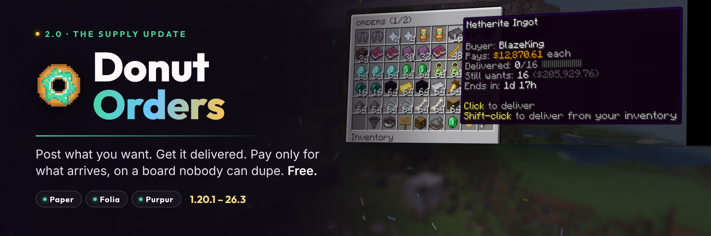

## The order board your players already know, made safe

**DonutOrders** is free, open-source buy orders for Paper, Folia and Purpur, from Minecraft **1.20.1 to 26.3**.

A player posts what they want and what they pay for each item, and the money is held right away. Anyone can open
`/orders`, drop the items in and get paid on the spot, or sell everything into the best orders with one command. The
buyer is told, collects whenever they like, and can raise the price, add items or cancel for a refund.

Every delivery, cancel and expiry is a database update that only one click, on one server, can win. Money moves only
after it does.

**2.0 "The Supply Update"** is a full rebuild. It adds the SMP board sorts, `/orders sell`, shulker delivery, price
insight, order editing, server orders, cross-server notifications, Discord, PlaceholderAPI and a developer API. Each
release is tested on every supported Paper and Folia version with real clients.

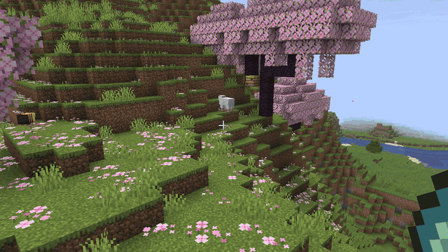

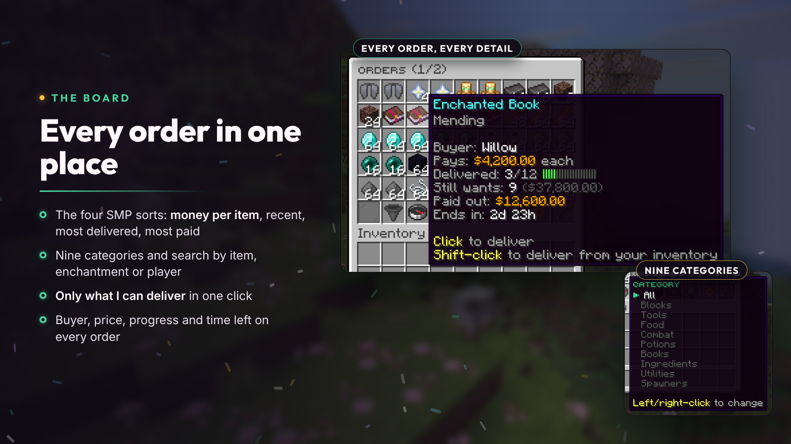

- **The four sorts players expect**: Money Per Item, Recently Listed, Most Delivered, Most Paid. Ending Soon is a
  fifth.
- **Nine categories**: blocks, tools, food, combat, potions, books, ingredients, utilities and spawners.
- **Search** by item, enchantment (`mending`) or player: `/orders diamond`.
- **Only what I can deliver**: one click hides every order you have nothing for.
- Each order shows the buyer, the price each, a progress bar, what is still wanted, what has been paid out and the
  time left.
- Item and enchantment names appear in each player's own language.

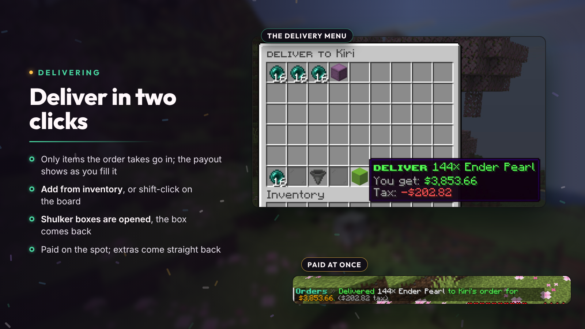

1. Click an order. The delivery menu only takes items the order accepts; wrong items are refused at the slot.
2. Drop items in, or click **Add from inventory**. The Deliver button shows what you will receive, after tax.
3. Click **Deliver** and you are paid at once. Anything the order did not need comes straight back.

**Shift-click** an order on the board to deliver from your inventory without opening anything. **Shulker boxes are
opened for you**: the order takes what it wants, and the box comes back with the rest still inside.

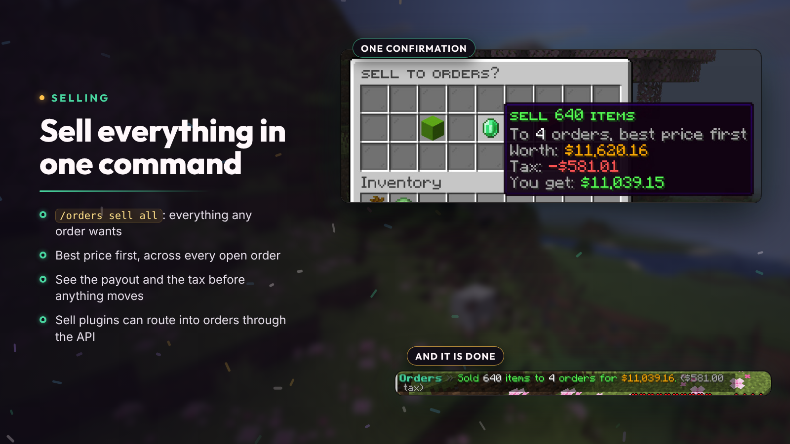

- `/orders sell` sells the item in your hand to the best-paying orders. `/orders sell all` sells everything any order
  wants.
- A confirmation shows how many items go to how many orders, what they are worth, the tax and what you get.
- The board has a **Sell to orders** button too.
- For server owners: other plugins can route `/sell` into orders through the API, so players always get the best
  price on the server.

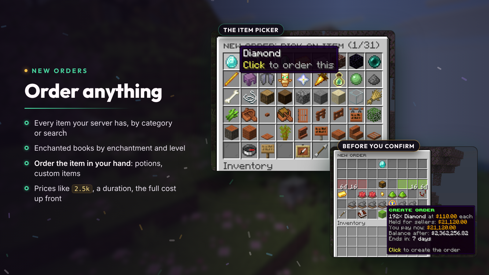

- **The item picker** lists every item your server has, by category or search, with your best sellers first.
- **Enchanted books**: pick the enchantment and level. The list comes from the server, so new and data-pack
  enchantments are there.
- **Order the item in your hand**: potions, goat horns, custom items, anything with variants. Only that exact item
  counts.
- Amount buttons or a typed number; a typed price (`2.5k`, `1m` and `3b` work); a duration from 1 hour to 30 days
  (configurable, longer by permission).
- The confirm button shows what is held for sellers, the fee and your balance afterwards.
- Or skip the menus: `/order create diamond 640 95 7d`.

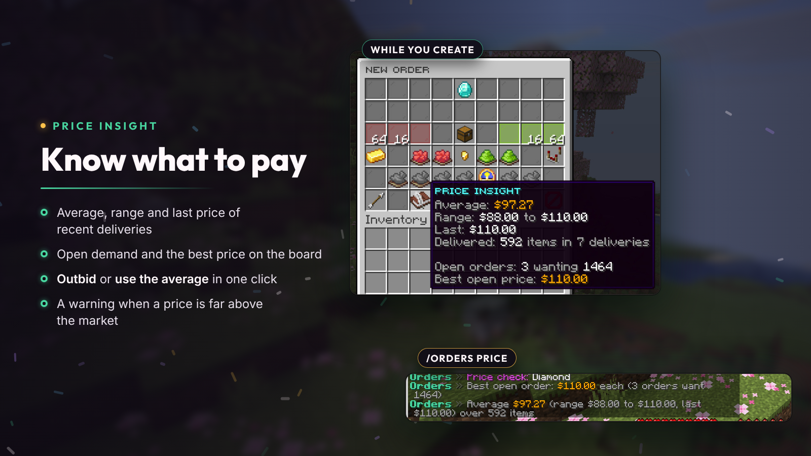

- The new-order menu shows the **average**, **range** and **last** price recent deliveries got, and how much was
  delivered.
- It also shows **open demand**: how many orders want the item and the best price on the board.
- **Outbid** sets your price just above the best order; **Use the average** sets it to the market.
- A warning appears when your price is far above the average (three times, configurable). Thin top orders cannot
  fool your players.
- `/orders price` tells you what the item in your hand sells for. PlaceholderAPI has it too:
  `%donutorders_best_DIAMOND%`, `%donutorders_average_DIAMOND%`.

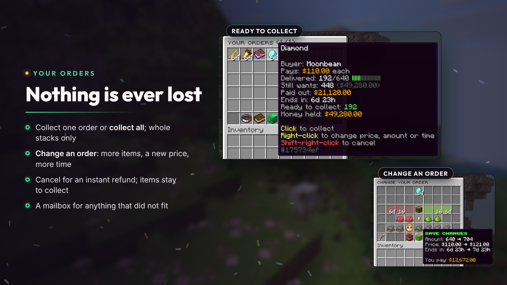

- `/order` lists your orders with what is ready to collect and the money still held.
- **Collect** one order, or **Collect all**. Items are only handed over as whole stacks that fit; the rest waits.
- **Change an order**: add items, raise or lower the price, add time. The difference is charged or refunded on the
  spot. Outbid the competition without starting over.
- **Cancel** for an instant refund of the money still held. Delivered items stay ready to collect.
- **Mailbox**: anything that did not fit in your inventory. **History**: your finished orders, your deliveries and
  your lifetime totals.

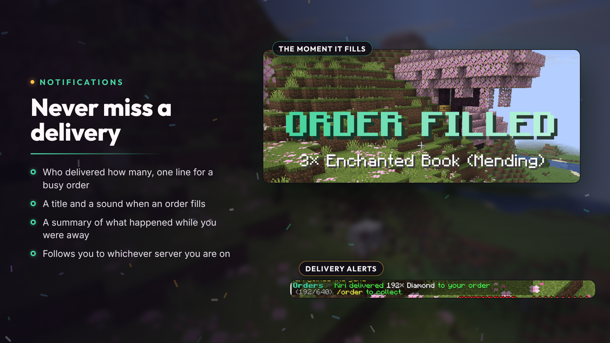

- **Delivered**: who delivered how many, and your progress. A busy order sends one line, not fifty. Chat, action
  bar or both.
- **Order filled**: a title and a sound.
- **While you were away**: deliveries, filled orders and refunds, summarised when you join.
- **Across servers**: buyers are told on whichever server they are on.
- **New orders** are announced with a clickable *[Deliver]* button (minimum value and cooldown configurable).
- `/order alerts` mutes alerts and announcements for players who want quiet.

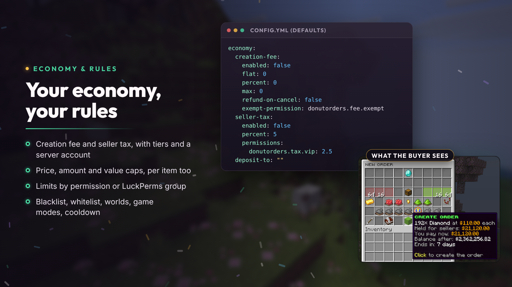

| Setting | What it does |
| --- | --- |
| `economy.creation-fee` | A flat fee and/or a percentage when creating an order, with a cap, a refund on cancel and an exempt permission. |
| `economy.seller-tax` | A share of every payout. Permission tiers lower it (`donutorders.tax.vip: 2.5`); `deposit-to` pays fees and tax to a server account. |
| `orders.price-limits` | Minimum and maximum price per item, by material or book (`DIAMOND: {min: 50}`). Plus caps on amount and total value. |
| `limits` | Open orders per player: a default (18), `donutorders.limit.<n>`, and LuckPerms groups. |
| `durations` | The choices players get, a maximum, and longer maximums by permission. |
| `matching` | Whether renamed, worn, enchanted or custom items count for plain orders, and how books match. |
| `blacklist` / `whitelist` | Materials (with wildcards like `*_SPAWN_EGG`), names, lore, model data and plugin data. |
| `restrictions` | Disabled worlds and game modes, a creation cooldown, and a freeze switch for staff. |

Fees and tax are off until you turn them on. Every rule has a bypass permission for staff.

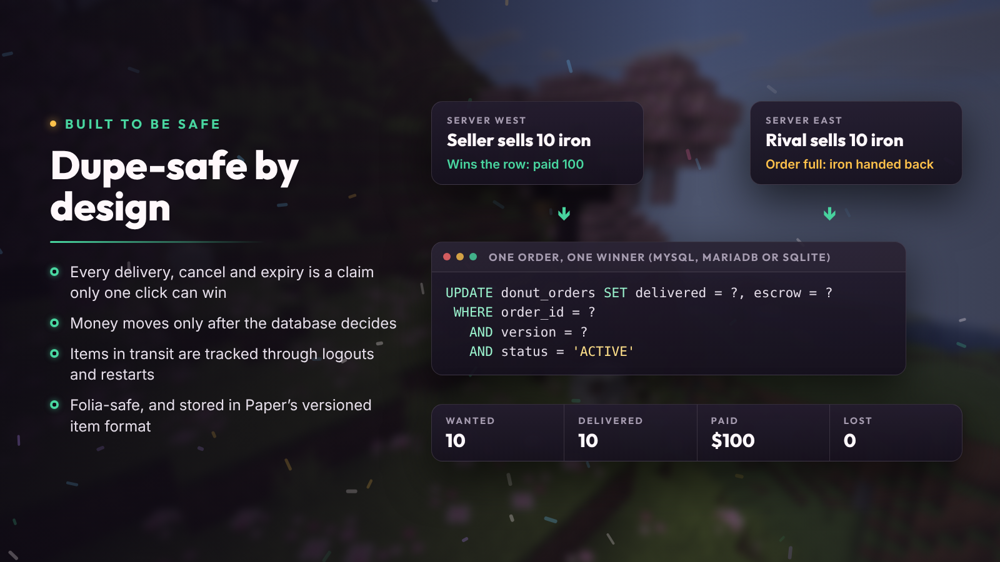

- **One winner per action.** Deliveries, cancels, expiries, edits and collections are conditional database updates.
  Double clicks, lag and two servers at once cannot overfill an order, pay twice or refund twice.
- **Tested, not promised.** Two sellers on two servers sold into the same order at the same moment. Exactly what
  it wanted was delivered, exactly that was paid, and the rest went back.
- **Money follows the database.** The held money is released by the same update that closes the order, so a refund
  happens exactly once.
- **Items in transit are tracked** until they are delivered or handed back, through logouts, deaths and server
  stops.
- **Folia-safe**: inventories only change on the player's own thread.
- **Upgrade-proof**: items are stored in Paper's versioned format, so orders survive Minecraft updates.
- **Matching that cannot be gamed**: a custom "Super Diamond" is never sold as a diamond, and a full shulker box is
  never sold as an empty one.

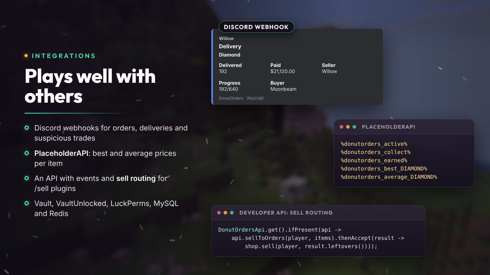

- **Discord webhooks**: new orders, deliveries, filled, cancelled and expired orders, and suspicious deliveries.
  Pick the events and a minimum value.
- **PlaceholderAPI**:

| Placeholder | Value |
| --- | --- |
| `%donutorders_active%`, `%donutorders_limit%`, `%donutorders_slots_left%` | Your open orders and limit |
| `%donutorders_collect%` | Items waiting for you |
| `%donutorders_delivered%`, `%donutorders_earned%` | Items you delivered and what you earned |
| `%donutorders_received%`, `%donutorders_spent%` | Items you received and what you paid |
| `%donutorders_market_active%`, `%donutorders_market_value%` | The whole board |
| `%donutorders_best_<ITEM>%`, `_average_<ITEM>%`, `_demand_<ITEM>%`, `_orders_<ITEM>%` | Prices and demand per item |

- **Developer API**: `DonutOrdersApi` reads orders and best prices, and sells items into orders (sell routing).
  It also creates server orders. Events: cancellable pre-create and pre-deliver, plus created, delivered and closed.
- **Server orders**: `/orderadmin server wheat unlimited 3 7d` adds demand paid by the server, for events and item
  sinks.
- Vault and VaultUnlocked economies, LuckPerms groups, MySQL or MariaDB with optional Redis, and bStats.

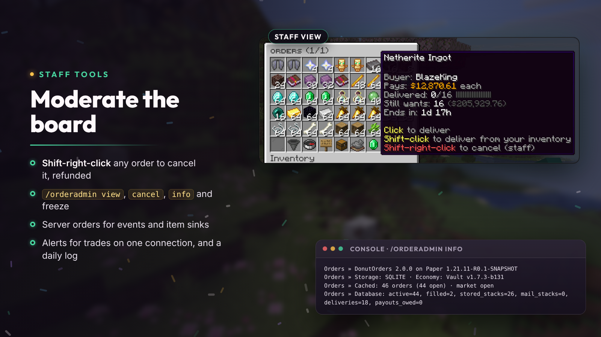

- **Shift-right-click** any order on the board to cancel it. The buyer gets the money back and is told why.
- `/orderadmin view <player>` and `history <player>`: a player's orders and history.
- `/orderadmin cancel <id> [reason]`, `info` (storage, open orders, database totals), `purge <days>`.
- **Freeze** the market for maintenance or an economy reset, then unfreeze it.
- **Suspicious deliveries** between players on one connection alert staff and Discord, or are blocked.
- A daily **transaction log** in `plugins/DonutOrders/logs/` records every order, delivery, edit, collection and
  refund.

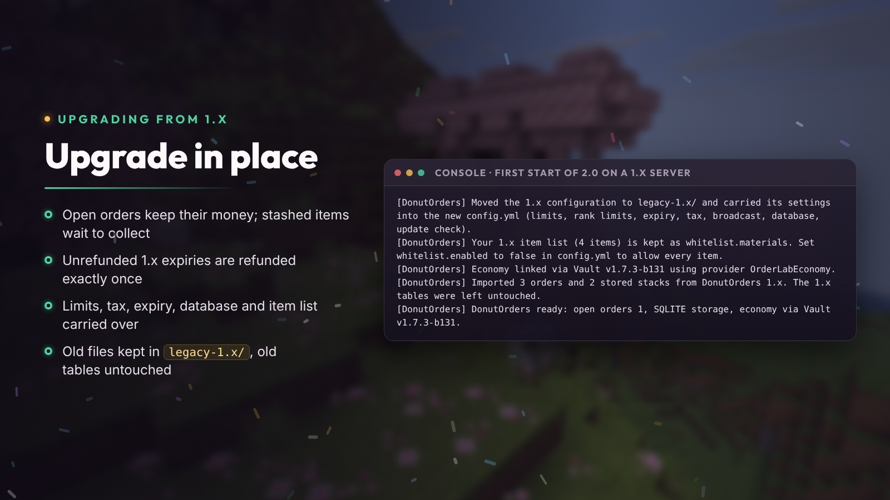

- Replace the jar and restart. Open orders keep their held money, and items waiting in 1.x stashes become
  collectable.
- Expired 1.x orders whose money was never refunded are refunded once.
- Your limits, rank limits, expiry, tax, broadcast, database and item list are carried into the new `config.yml`.
  The old files are kept in `legacy-1.x/`, and the 1.x tables are left untouched.

- `config.yml` is fully commented: storage and sync, prices and limits, durations, fees and tax, matching, delivery,
  rules, insight, notifications, broadcasts, menus, sounds, Discord. New settings are added automatically when you
  update; your values are kept.
- `messages.yml` has every word players see, menus included. Use **MiniMessage**, `&` codes or `&#RRGGBB` hex, mixed
  freely. Optional small caps in menu titles and buttons, as on the big SMP servers. Player-made text can never add
  colors or click events.
- Change any button's item and resource-pack model under `menus.buttons`.
- `/orderadmin reload` applies everything without a restart.

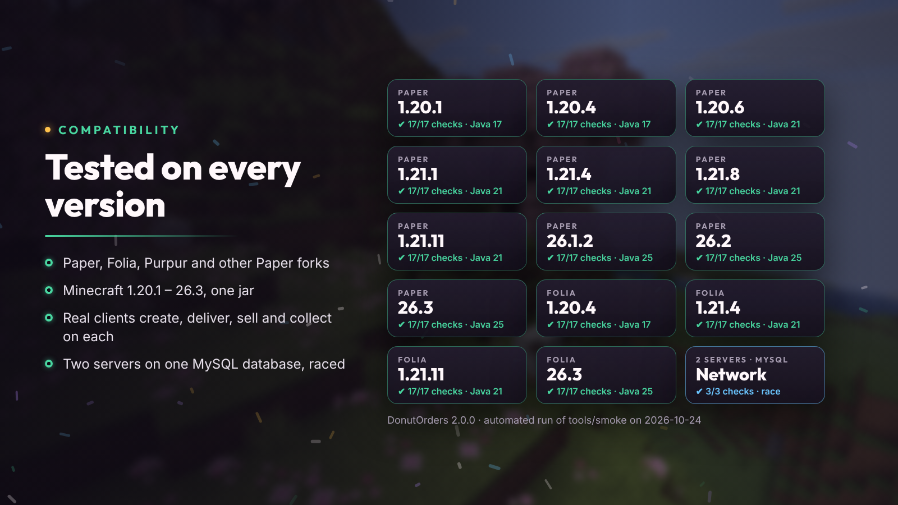

| Server | Minecraft | Java | Notes |
| --- | --- | --- | --- |
| Paper, Purpur, other Paper forks | 1.20.1 – 1.20.4 | 17+ | |
| Paper, Purpur, other Paper forks | 1.20.5 – 1.21.11 | 21+ | |
| Paper, Purpur, other Paper forks | 26.1 – 26.3 | 25+ | |
| Folia | 1.20.4 – 26.3 | as above | Region-thread safe |
| Spigot, Bukkit | — | — | Not supported in 2.0: they lack Paper's API. The plugin says so and disables itself. |

- Needs **Vault** or **VaultUnlocked** and an economy plugin (EssentialsX, CMI, and others).
- Optional: PlaceholderAPI, LuckPerms, MySQL or MariaDB, and Redis.
- One jar for every version. Install it on the server only; players need no mods.
- Each release runs an automated matrix on real servers: Paper 1.20.1, 1.20.4, 1.20.6, 1.21.1, 1.21.4, 1.21.8,
  1.21.11, 26.1.2, 26.2 and 26.3, and Folia 1.20.4, 1.21.4, 1.21.11 and 26.3. Real clients create, deliver, sell,
  collect, cancel and expire orders on each.
- A second test runs two servers on one MySQL database.

| Command | What it does | Permission |
| --- | --- | --- |
| `/orders` (`/market`) | The order board | `donutorders.use` |
| `/orders <search>` | Orders for an item, enchantment or player | `donutorders.use` |
| `/orders sell [all]` | Sell to the best orders | `donutorders.sell` |
| `/orders price` | What the held item sells for | `donutorders.use` |
| `/orders view <player>` | A player's open orders | `donutorders.use` |
| `/order` | Your orders: collect, change, cancel | `donutorders.use` |
| `/order new` | Create an order from the item picker | `donutorders.create` |
| `/order create <item\|hand> <amount> <price> [time]` | Create without menus | `donutorders.create` |
| `/order collect`, `mailbox`, `history`, `alerts`, `cancel <id>` | Shortcuts | `donutorders.use` |
| `/orderadmin view\|history\|cancel\|server\|purge\|info\|freeze\|reload` | Staff tools | `donutorders.admin` |

Limits use `donutorders.limit.<n>` (or `.unlimited`). Ordering the exact held item needs `donutorders.create.exact`.
The 1.x permissions and `%donutorders_order_limit%` keep working.

**Is it really free?**
Yes, all of it: the board, selling into orders, shulker delivery, price insight, editing, server orders, webhooks,
PlaceholderAPI, cross-server and the API. The source is on GitHub under Apache-2.0.

**I'm updating from 1.x. Will I lose anything?**
No. Open orders, held money, stashed items and your settings are carried over, and the old files are kept. Back up
your database first, as with any update.

**Does it work on Spigot?**
Not since 2.0. DonutOrders uses Paper's API (Adventure text, region schedulers). Paper is a drop-in replacement for
Spigot, and Purpur and other Paper forks work too.

**Can players dupe items or money with it?**
Every delivery, cancel, expiry, edit and collection is a conditional database update that only one action can win.
Money moves only after it. Items in transit are tracked until they are delivered or handed back, and nothing is ever
dropped on the ground. If you ever find a way, please report it privately (see SECURITY.md on GitHub).

**What stops someone selling a renamed or custom item as the real thing?**
Plain orders refuse renamed, worn and custom items (custom model data, plugin data, lore) by default, and each is a
setting. Exact orders compare the whole item, or a custom-item plugin's id.

**How do I share one board between servers?**
Set `storage.type: MYSQL` on every server with the same database. Optionally enable `sync.redis` for instant
updates. Buyers are told about deliveries on whichever server they are on.

**Can my `/sell` plugin sell into orders?**
Yes. `DonutOrdersApi#sellToOrders` sells items into the best orders and hands back what no order wanted.
`bestPrice` tells you what orders pay.

**Where are the docs?**
[README](https://github.com/MeherBenSalem/DonutOrders#readme) ·
[Release notes](https://github.com/MeherBenSalem/DonutOrders/blob/main/DonutOrders-2.0.0-PatchNotes.md) ·
[Issues](https://github.com/MeherBenSalem/DonutOrders/issues)

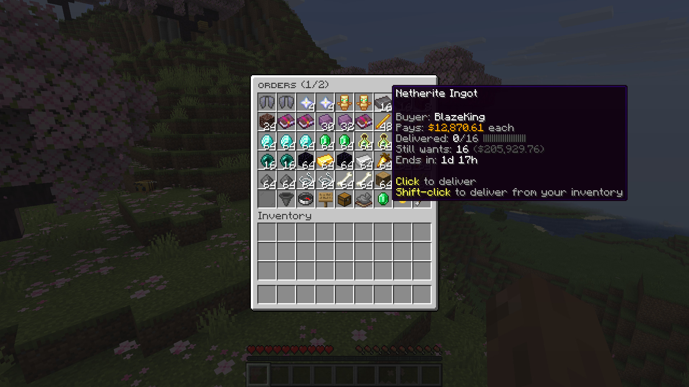

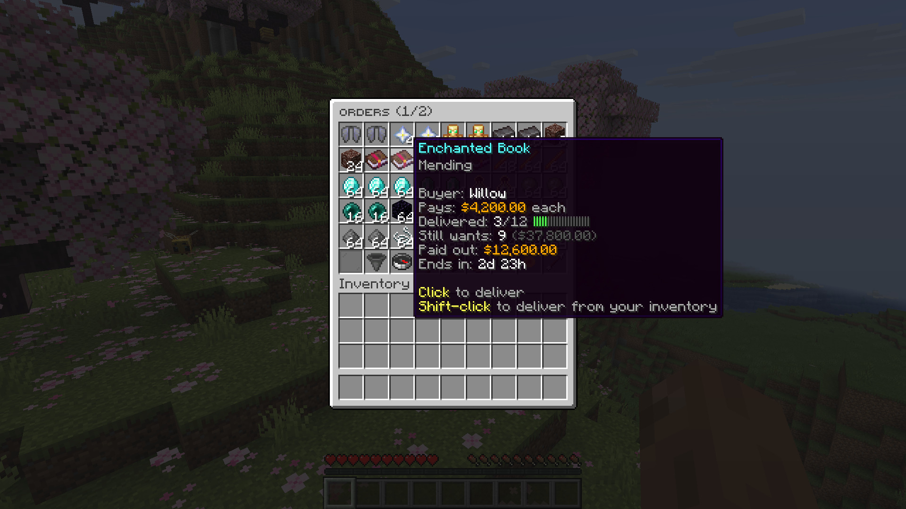

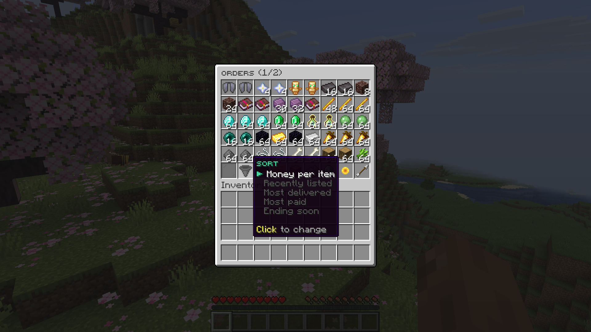

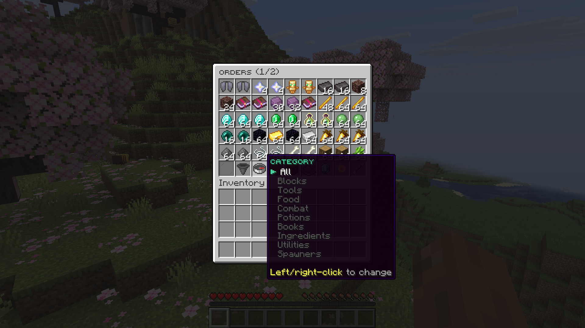

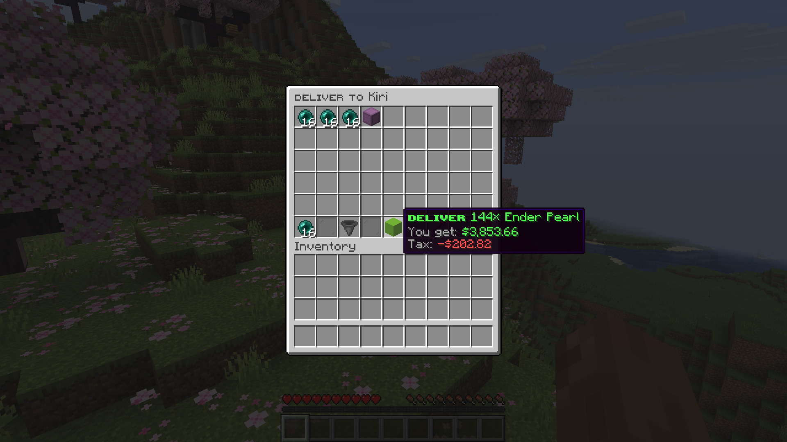

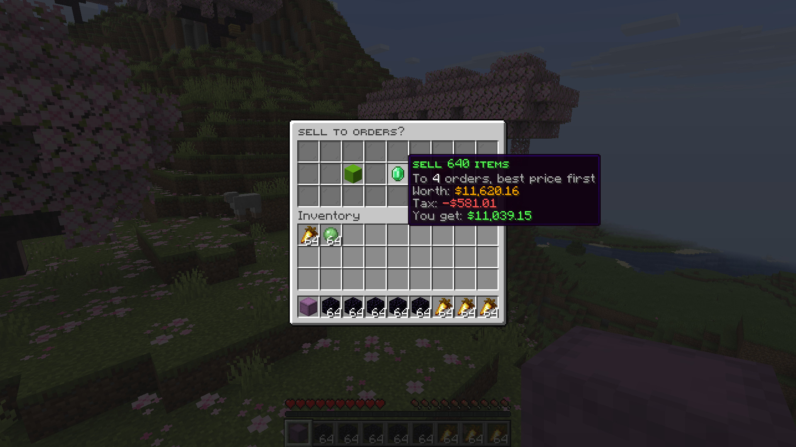

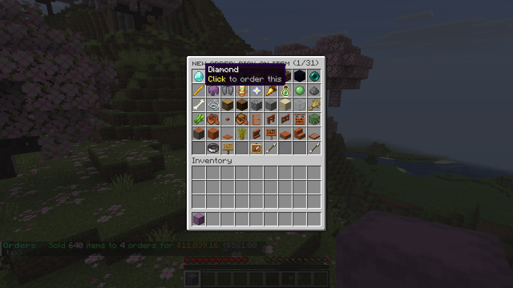

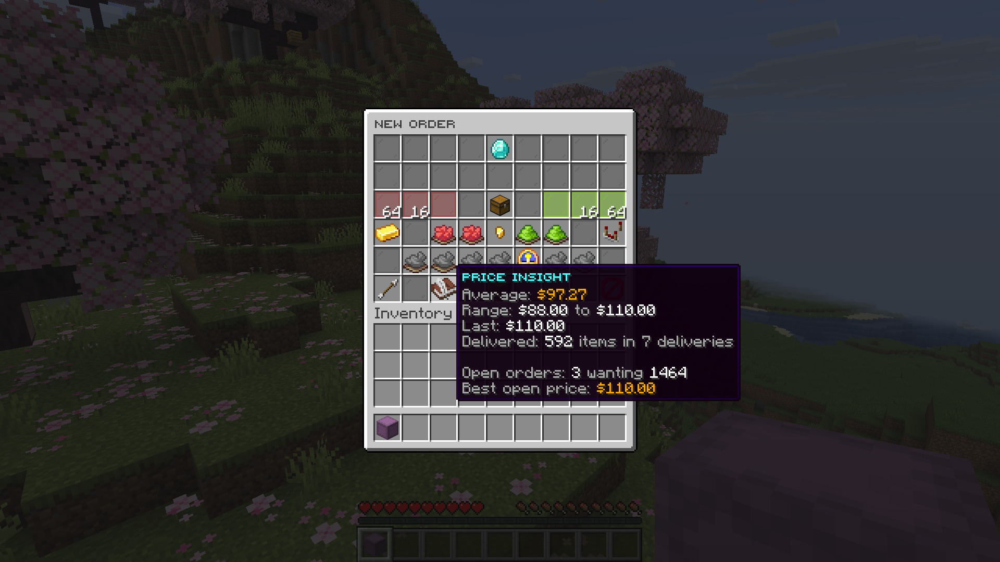

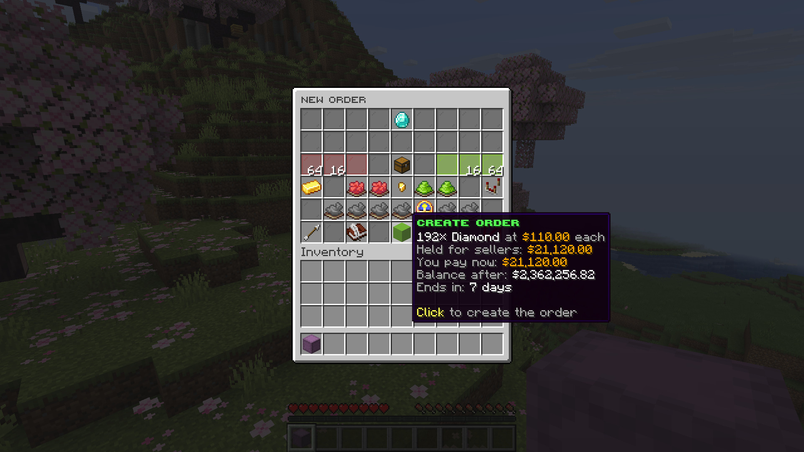

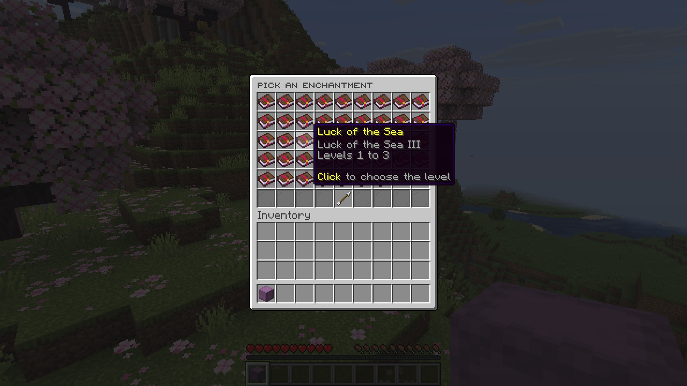

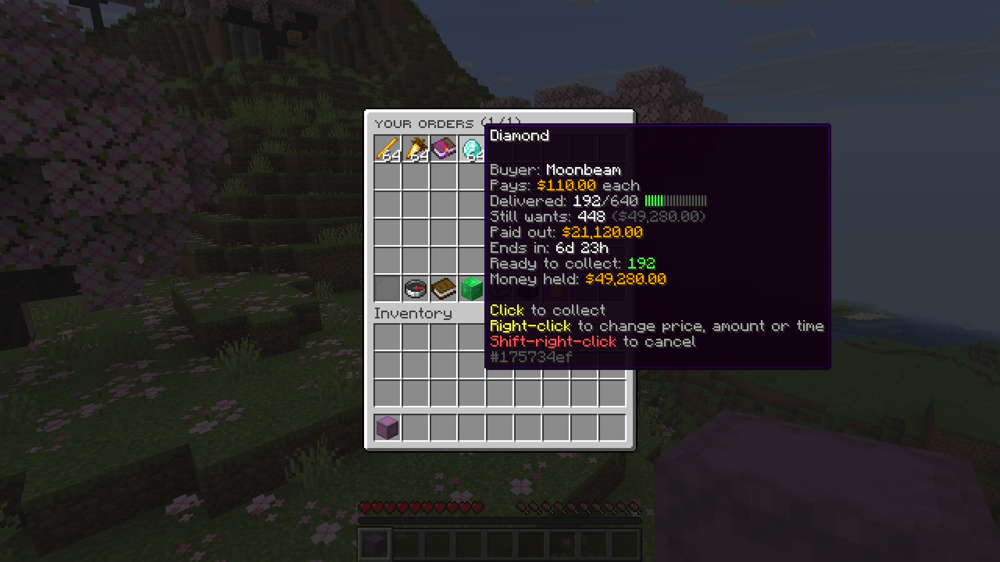

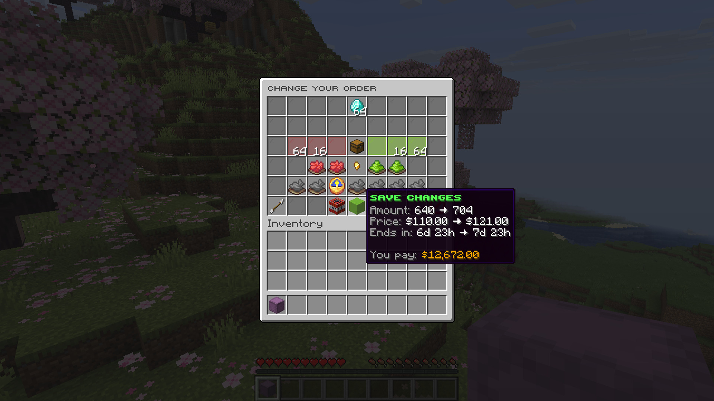

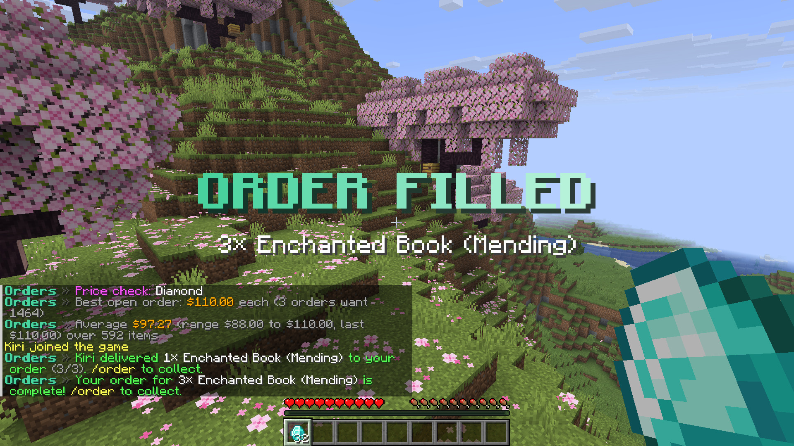

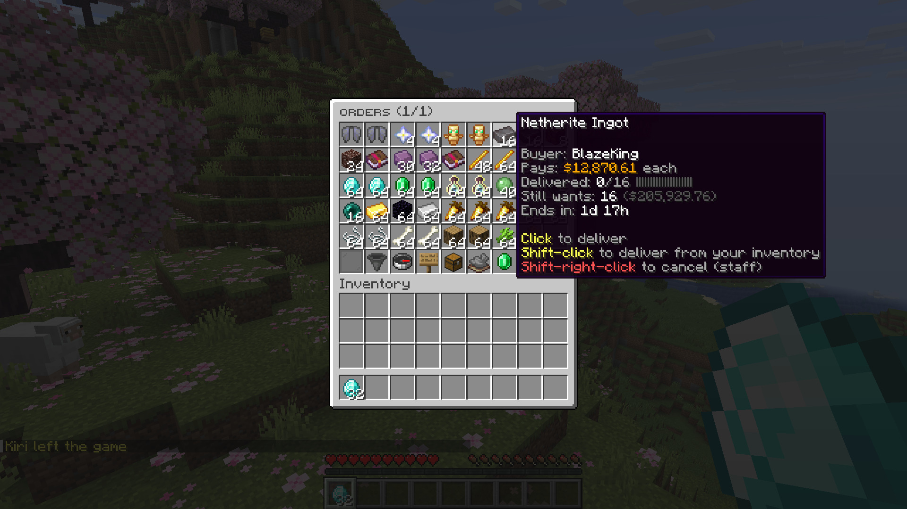

---

DonutOrders is licensed under Apache-2.0. The Outfit and Inter fonts used in this artwork are licensed under the SIL
Open Font License 1.1. Screenshots are unedited captures of the vanilla Minecraft client on a Paper server running
the plugin. DonutOrders is an independent project and is not affiliated with Mojang, Microsoft or any server it takes
inspiration from.
